# 📘 학교메신저 사용 설명서

> 대상 버전: **0.9.10** · 설치부터 일상 사용, 관리자 업무까지 순서대로 따라 할 수 있게 정리했습니다.
> 화면 속 이름·주소는 모두 예시입니다 (예시 학교: 금구중학교, 예시 서버 주소: `10.112.120.42:7777`).

## 목차

1. [구성 한눈에 보기](#1-구성-한눈에-보기)
2. [준비물](#2-준비물)
3. [서버 설치 (학교에 1대)](#3-서버-설치-학교에-1대)
4. [교직원 계정 만들기](#4-교직원-계정-만들기)
5. [클라이언트 설치 (교직원 PC마다)](#5-클라이언트-설치-교직원-pc마다)
6. [화면 둘러보기](#6-화면-둘러보기)
7. [쪽지](#7-쪽지)
8. [쪽지·공지 창 여러 개 띄우기](#8-쪽지공지-창-여러-개-띄우기)
9. [대화와 채팅방](#9-대화와-채팅방)
10. [공지사항과 설문조사](#10-공지사항과-설문조사)
11. [조직도와 사용자 그룹](#11-조직도와-사용자-그룹)
12. [내 정보·설정](#12-내-정보설정)
13. [관리자 기능](#13-관리자-기능)
14. [업데이트 방법](#14-업데이트-방법)
15. [자주 묻는 질문 / 문제 해결](#15-자주-묻는-질문--문제-해결)

---

## 1. 구성 한눈에 보기

학교메신저는 **서버 1대 + 교직원 PC마다 클라이언트**로 동작합니다. 외부 인터넷 없이 학교 내부망만으로 쓸 수 있습니다.

```
            ┌──────────────────────────────┐
            │  서버 PC (교무실 등, 항상 켜 둠)   │
            │  SchoolMessenger-Server      │
            │  계정·쪽지·첨부파일 저장          │
            └──────────────┬───────────────┘
                           │  교내망 (포트 7777)
     ┌──────────────┬──────┴───────┬──────────────┐
  교사 PC         교사 PC          행정실 PC        …
  (클라이언트)     (클라이언트)       (클라이언트)
```

| 설치파일 | 어디에 | 몇 대 |
|---|---|---|
| `SchoolMessenger-Server-Setup-0.9.10.exe` | 항상 켜져 있는 PC 1대 | 학교당 1대 |
| `SchoolMessenger-Client-Setup-0.9.10.exe` | 교직원 각자의 PC | 사용하는 PC마다 |

## 2. 준비물

- **서버 PC**: Windows 10/11, 업무 시간 내내 켜져 있는 PC (교무실·전산실 PC 등). 절전 모드로 들어가지 않게 설정해 두세요.
- **설치파일 2개**: 서버용·클라이언트용 (위 표 참고)
- **교직원 명단**(선택): 엑셀로 한 번에 계정을 만들 때 필요합니다. → [4-2](#4-2-엑셀로-한꺼번에-만들기)
- 서버 PC와 교직원 PC가 **같은 교내망**에 연결되어 있어야 합니다.

---

## 3. 서버 설치 (학교에 1대)

### 3-1. 설치파일 실행

1. 서버 PC에서 `SchoolMessenger-Server-Setup-0.9.10.exe`를 더블클릭합니다.
2. "Windows의 PC 보호" 파란 창이 뜨면 **[추가 정보] → [실행]**을 누릅니다. (학교에서 만든 프로그램이라 서명이 없어서 뜨는 안내입니다.)
3. 설치 폴더는 그대로 두고 **[설치]** → **[마침]**. 바탕화면에 **학교메신저 서버** 아이콘이 생깁니다.

### 3-2. 학교 이름 입력

처음 실행하면 학교 이름을 묻습니다. 입력한 이름은 서버 제목줄과 **모든 교직원 메신저 화면 위쪽**에 표시됩니다.

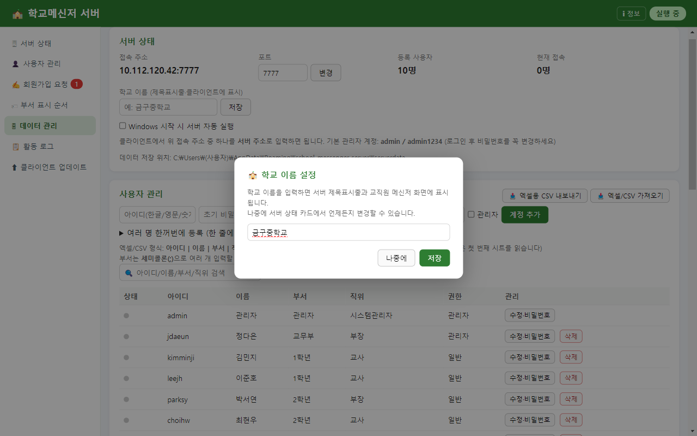

- 나중에 [서버 상태] 카드의 **학교 이름** 칸에서 언제든 바꿀 수 있습니다.

### 3-3. Windows 방화벽 허용

처음 실행할 때 "Windows 보안 경고(방화벽)" 창이 뜨면 **[허용]**을 누릅니다.
이걸 허용하지 않으면 다른 PC에서 서버에 접속할 수 없습니다. (실수로 취소했다면 [15. 문제 해결](#15-자주-묻는-질문--문제-해결) 참고)

### 3-4. 접속 주소 확인

관리 화면 맨 위 **[서버 상태]** 카드에 **접속 주소**가 나옵니다. 교직원 PC에서 이 주소를 입력해 접속하므로 적어 두세요.

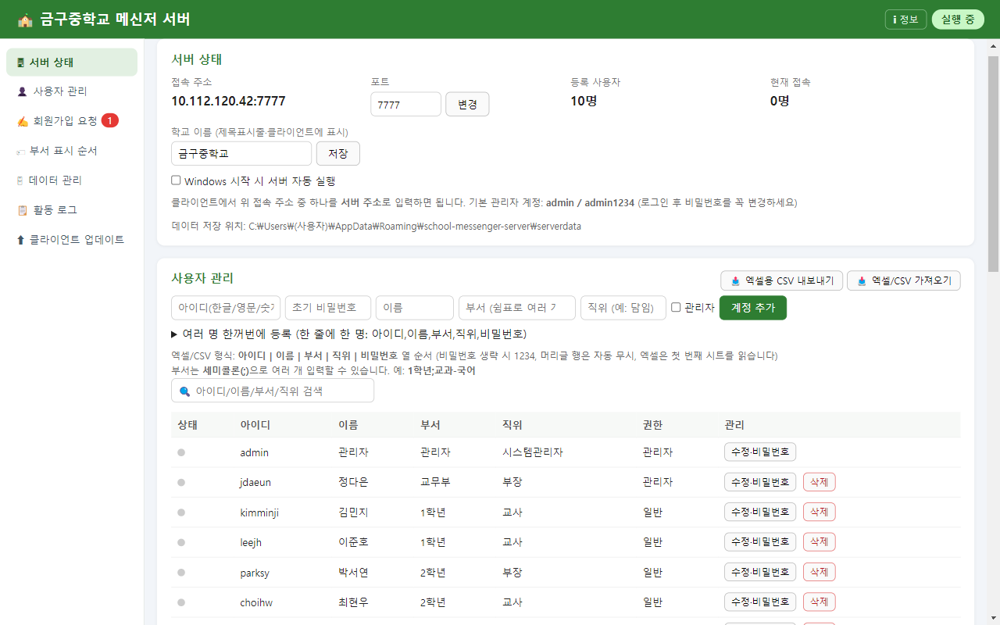

- 유선·무선 등 네트워크가 여러 개면 주소가 여러 개 표시됩니다. 클라이언트 로그인 화면에 **쉼표로 여러 개**를 넣어 두면 연결되는 주소로 자동 접속합니다.
  예: `10.112.120.42:7777, 10.52.72.142:7777`
- 포트(기본 7777)는 바꿀 수 있지만, 바꾸면 교직원 PC의 서버 주소도 같이 바꿔야 합니다.

### 3-5. 서버 PC가 켜질 때 자동 실행

[서버 상태] 카드의 **☑ Windows 시작 시 서버 자동 실행**을 켜 두세요. 서버 PC를 재부팅해도 메신저 서버가 알아서 다시 켜집니다.

### 3-6. 관리 창을 닫아도 서버는 계속 동작

- 관리 창의 ✕를 눌러도 서버는 **작업표시줄 오른쪽 트레이 아이콘**으로 계속 실행됩니다.
- 관리 화면 다시 열기: 트레이 아이콘 더블클릭 또는 우클릭 → **관리 화면 열기**
- 서버를 완전히 끄기: 트레이 아이콘 우클릭 → **서버 종료** (이때는 아무도 메신저를 쓸 수 없습니다)

### 3-7. 기본 관리자 비밀번호 바꾸기 (꼭!)

처음에는 관리자 계정 **`admin` / `admin1234`**가 만들어져 있습니다.
[사용자 관리]에서 admin 줄의 **[수정·비밀번호]**를 눌러 비밀번호를 바꾸세요.

---

## 4. 교직원 계정 만들기

계정을 만드는 방법은 세 가지입니다. 편한 방법을 고르세요.

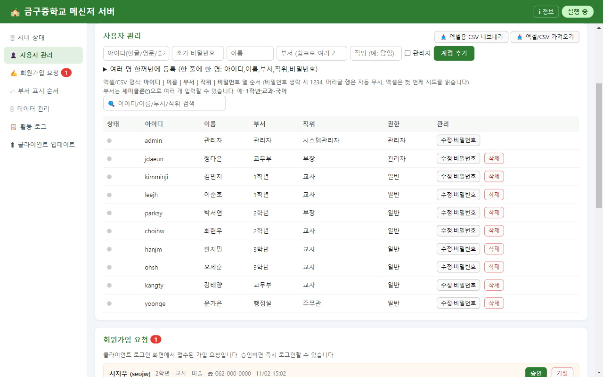

### 4-1. 한 명씩 만들기

[사용자 관리] 카드의 입력칸에 **아이디 · 초기 비밀번호 · 이름 · 부서 · 직위**를 넣고 **[계정 추가]**.

- 부서는 쉼표로 여러 개 넣으면 여러 부서에 동시에 소속됩니다. (예: `1학년, 교무부`)
- 하위 부서는 `-`로 이어 씁니다. (예: `교과-국어` → 조직도에 "교과 ▸ 국어"로 표시)
- **☑ 관리자**를 체크하면 그 교사도 메신저 안에서 계정 관리·가입 승인을 할 수 있습니다.

### 4-2. 엑셀로 한꺼번에 만들기

1. 엑셀에 아래 순서로 열을 만듭니다. (첫 줄 제목은 있어도 자동으로 건너뜁니다)

   | 아이디 | 이름 | 부서 | 직위 | 비밀번호 |
   |---|---|---|---|---|
   | kimminji | 김민지 | 1학년 | 교사 | 1234 |
   | yoonge | 윤가은 | 행정실 | 주무관 | |

   - 비밀번호를 비우면 `1234`로 만들어집니다.
   - 엑셀 칸 안에서 부서를 여러 개 쓸 때는 **세미콜론(;)**으로 구분합니다. (예: `1학년;교과-국어`)
2. **[엑셀/CSV 가져오기]** → 파일 선택.
3. 현재 명단을 엑셀로 받으려면 **[엑셀용 CSV 내보내기]**.

> 💡 "여러 명 한꺼번에 등록"을 펼치면 엑셀 없이 `아이디,이름,부서,직위,비밀번호`를 한 줄에 한 명씩 붙여넣어 등록할 수도 있습니다.

### 4-3. 교직원이 직접 가입 요청 → 관리자 승인

교직원이 클라이언트 로그인 화면에서 **[✍ 회원가입 요청]**을 보내면, 관리자가 승인해야 로그인할 수 있습니다.

- 서버 관리 화면: **[회원가입 요청]** 카드에서 **[승인] / [거절]**

  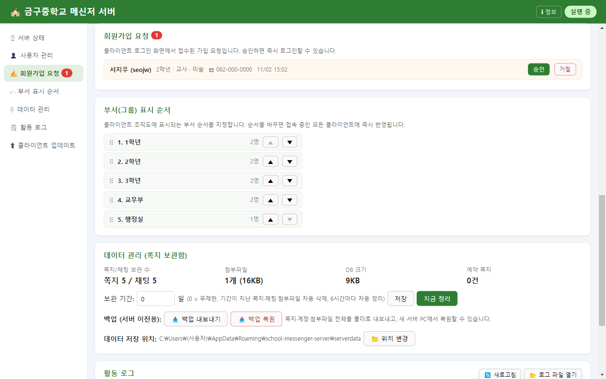

- 메신저(관리자 권한 계정): 요청이 오면 알림이 뜨고, 상단 **[가입요청]** 버튼(빨간 숫자 = 대기 건수)에서 바로 승인할 수 있습니다. → [13-1](#13-1-메신저에서-가입-승인)

### 4-4. 조직도 부서 순서 정하기

**[부서 표시 순서]** 카드에서 ▲▼ 버튼이나 끌어서 순서를 바꾸면 모든 교직원 조직도에 바로 반영됩니다.

---

## 5. 클라이언트 설치 (교직원 PC마다)

### 5-1. 설치

1. `SchoolMessenger-Client-Setup-0.9.10.exe` 더블클릭
2. "Windows의 PC 보호" 창이 뜨면 **[추가 정보] → [실행]**
3. **[설치]** → **[마침]** → 바탕화면의 **학교메신저** 아이콘으로 실행

### 5-2. 로그인

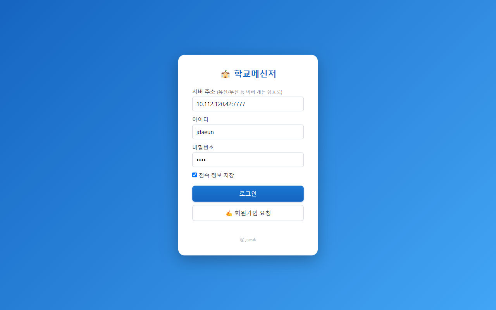

1. **서버 주소**: 서버 관리 화면에 나온 접속 주소 (예: `10.112.120.42:7777`)
   - 여러 개면 쉼표로: `10.112.120.42:7777, 10.52.72.142:7777`
2. **아이디 / 비밀번호**: 관리자에게 받은 계정
3. **☑ 접속 정보 저장**을 켜 두면 다음부터 자동으로 채워집니다.
4. **[로그인]**

### 5-3. 계정이 없으면: 회원가입 요청

로그인 화면의 **[✍ 회원가입 요청]**을 눌러 정보를 입력하고 **[가입 요청 보내기]**. 관리자가 승인하면 바로 로그인할 수 있습니다.

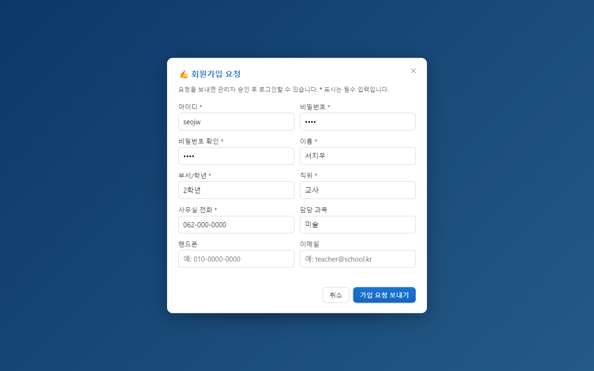

### 5-4. 처음 로그인한 뒤 할 일

- 상단 **[내 정보]**에서 사무실 위치·담당 과목·전화번호를 채우고 **비밀번호를 바꾸세요.**
- 상단 **[설정]**에서 **☑ Windows 시작 시 자동 실행**을 켜 두면 PC를 켤 때마다 메신저가 자동으로 켜집니다.

---

## 6. 화면 둘러보기

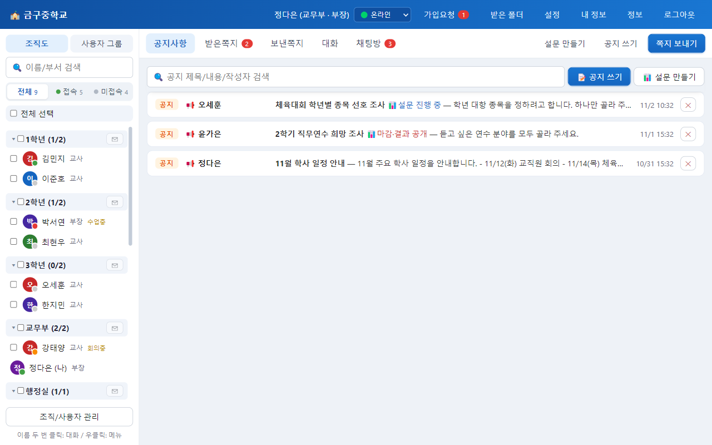

| 위치 | 내용 |
|---|---|
| 맨 위 왼쪽 | 학교 이름 |
| 맨 위 가운데 | 내 이름과 **상태** (🟢 온라인 · 🟡 자리비움 · 🔴 수업중 · 🟠 회의중) — 다른 선생님 조직도에 표시됩니다 |
| 맨 위 오른쪽 | [가입요청](관리자만) · [받은 폴더](첨부파일 저장 폴더 열기) · [설정] · [내 정보] · [정보] · [로그아웃] |
| 왼쪽 | **조직도 / 사용자 그룹** 탭, 이름·부서 검색, **[전체] [접속] [미접속]** 필터 |
| 가운데 탭 | **공지사항 · 받은쪽지 · 보낸쪽지 · 대화 · 채팅방** (빨간 숫자 = 안 읽은 개수) |
| 오른쪽 위 | [설문 만들기] · [공지 쓰기] · **[쪽지 보내기]** |

- 창의 ✕를 눌러도 메신저는 꺼지지 않고 **트레이**에서 알림을 계속 받습니다. 완전히 끄려면 트레이 아이콘 우클릭 → **종료**.

---

## 7. 쪽지

### 7-1. 받은쪽지함

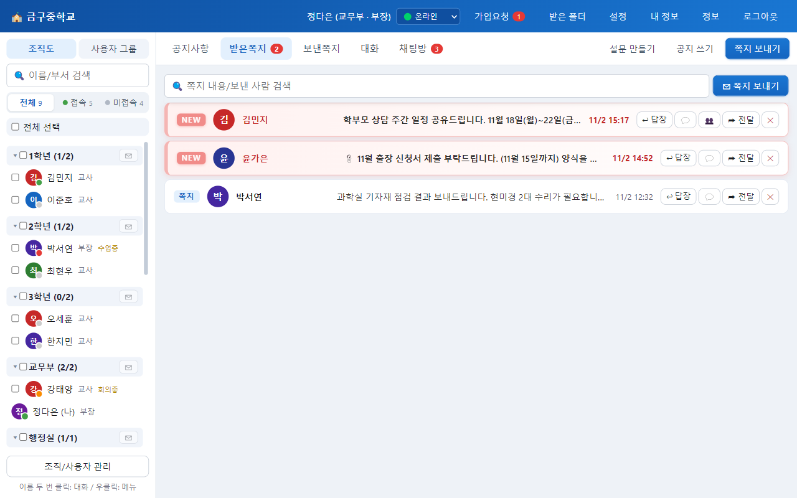

- 안 읽은 쪽지는 빨간 **[NEW]** 라벨과 분홍 배경으로 강조됩니다. 받은쪽지 탭을 누르면 항상 최신 쪽지부터 보입니다.
- 줄을 누르면 쪽지 창이 열립니다. 줄 오른쪽 버튼: **↩ 답장 · 💬 대화 · 👥 그룹 만들기 · ➦ 전달 · ✕ 삭제**
- **검색**: 받은쪽지함은 보낸 사람·내용·첨부파일 이름, 보낸쪽지함은 받는 사람·내용·첨부파일 이름으로 찾습니다. 검색창의 ✕로 검색어를 한 번에 지웁니다.

### 7-2. 쪽지 보내기

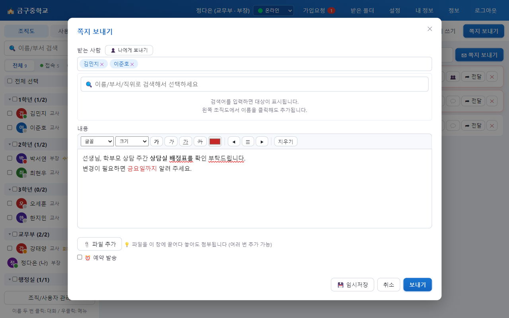

1. 오른쪽 위 **[쪽지 보내기]**를 누릅니다.
2. **받는 사람** 정하기 (여러 방법을 섞어 써도 됩니다)
   - 검색칸에 이름·부서·직위를 입력해서 고르기
   - 왼쪽 **조직도에서 이름을 클릭** (부서 옆 ✉ 버튼 = 그 부서 전체)
   - 조직도 체크박스로 여러 명 고른 뒤 위쪽 **✉** 버튼 (👥 버튼 = 고른 사람들로 사용자 그룹 만들기)
   - **[👤 나에게 보내기]**: 나에게 메모처럼 보내기 (받은쪽지함에 [메모]로 표시)
3. **내용** 쓰기: 글꼴·크기·굵게·기울임·밑줄·취소선·글자색·정렬을 쓸 수 있습니다.
   - 그림을 복사해서 본문에 **붙여넣기(Ctrl+V)**하면 바로 들어갑니다.
4. **파일 첨부**: [📎 파일 추가] 또는 파일을 창에 **끌어다 놓기** (여러 번 추가 가능, 최대 200MB)
5. **⏰ 예약 발송**: 체크하고 시각을 고르면 그 시각에 자동으로 보내집니다. (보낸쪽지함에서 예약 취소 가능)
6. **[보내기]** (쓰다가 멈출 때는 [💾 임시저장])

### 7-3. 답장·전달·회수·삭제

| 기능 | 방법 | 설명 |
|---|---|---|
| 답장 | 쪽지 창 또는 목록의 **[답장]** | 원본이 아래에 붙고 커서가 본문 맨 앞에 옵니다 |
| 전달 | **[전달]** | 첨부파일까지 그대로 다른 사람에게 보냅니다 |
| 회수 | 보낸쪽지 창의 **[회수]** | 상대가 **이미 읽었어도** 상대 쪽지함에서 사라집니다 |
| 삭제 | **[삭제]** / ✕ | **내 쪽지함에서만** 지워집니다 (상대방 것은 그대로) |
| 인쇄 | **[🖨 인쇄]** | 쪽지 내용을 인쇄합니다 |

### 7-4. 첨부파일 열기

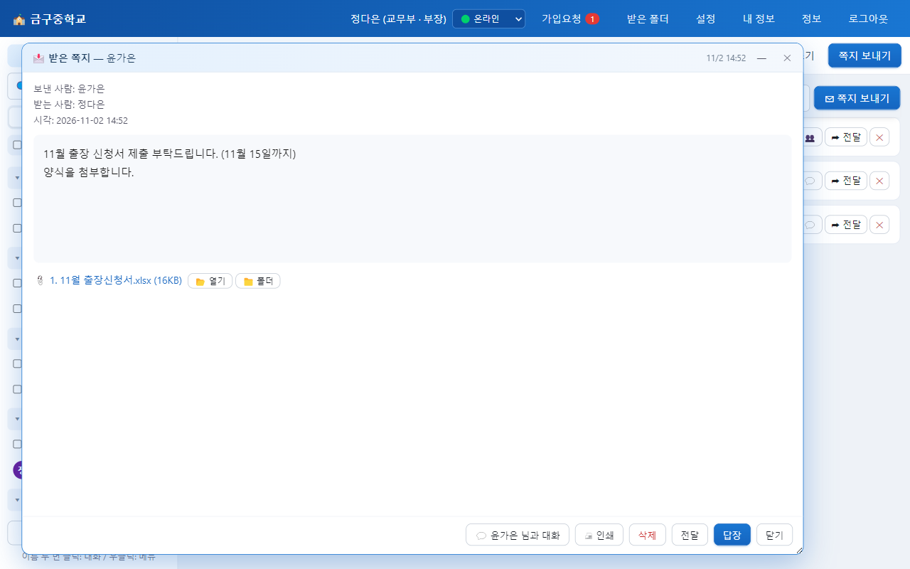

- 첨부파일 이름을 누르면 **첨부파일 저장 폴더**(기본 `문서\schoolmessenger`)에 저장됩니다.
- **[📂 열기]**: 바로 실행 (아직 안 받았으면 받은 뒤 실행) · **[📁 폴더]**: 저장된 폴더 열기
- 사진·영상·소리 파일은 쪽지 안에서 바로 미리 보거나 재생할 수 있습니다.
- 그림 위에서 **마우스 오른쪽 버튼** → 그림 저장 / 그림 복사

---

## 8. 쪽지·공지 창 여러 개 띄우기

받은쪽지·보낸쪽지·**공지사항**을 누를 때마다 **각각 따로 떠 있는 큰 창**으로 열립니다. 여러 개를 동시에 띄워 놓고 비교하거나 참고할 수 있습니다.

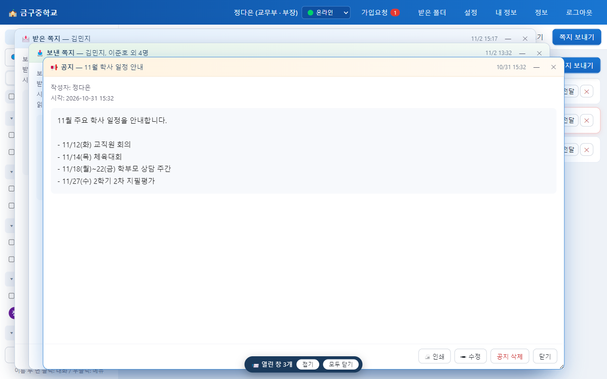

| 창 색깔 | 종류 |
|---|---|
| 파란 제목줄 📩 | 받은 쪽지 |
| 초록 제목줄 📤 | 보낸 쪽지 (읽은 사람 표시, [회수] 가능) |
| 주황 제목줄 📢 | 공지 (설문 투표·결과·엑셀 저장, 작성자는 [수정]·[공지 삭제]) |

- **옮기기**: 제목줄을 끌어서 / **크기 바꾸기**: 오른쪽 아래 모서리를 끌어서
- **[—] 접기**: 제목줄만 남기고 접기 (다시 누르면 펴짐)
- **닫기**: 오른쪽 위 ✕, [닫기] 버튼, 또는 **Esc** (맨 앞 창부터 닫힘)
- 이미 열린 쪽지·공지를 다시 누르면 새 창 대신 **그 창이 맨 앞으로** 올라옵니다.
- 창이 2개 이상이면 화면 아래에 **"📨 열린 창 N개 [접기] [모두 닫기]"**가 나타납니다.
- 공지 창은 내용이 바뀌면(수정·투표 등) **창이 열린 채로 바로 새로 고쳐집니다.** 공지가 삭제되면 창도 닫힙니다.

### 쪽지를 보면서 답장 쓰기

쪽지 창을 띄운 채 [답장]이나 [쪽지 보내기]를 누르면 **쓰기 창은 왼쪽**, **쪽지 창들은 오른쪽**으로 자동 정렬되어 서로 가리지 않습니다. 쓰기 창을 닫으면 원래 자리로 돌아갑니다.

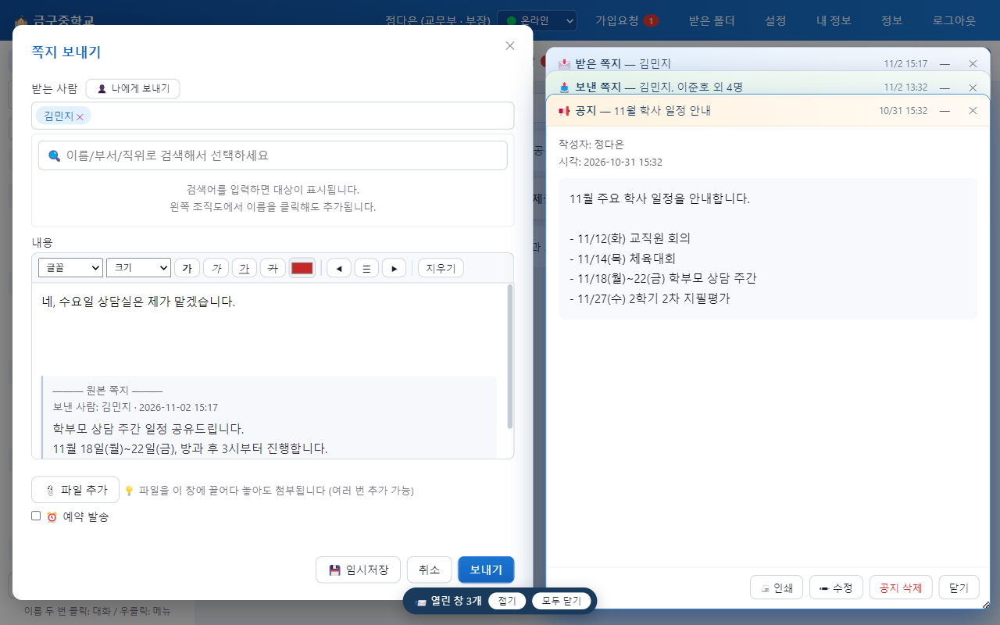

---

## 9. 대화와 채팅방

### 9-1. 1:1 대화

- 조직도에서 **이름을 두 번 클릭**하거나 우클릭 → **💬 대화하기**
- **Enter** = 보내기, **Shift+Enter** = 줄바꿈
- 파일은 입력창 위로 **끌어다 놓거나** 그림을 **붙여넣기** → 첨부 목록에 쌓였다가 [전송] 때 함께 보내집니다 (✕로 개별 취소).

### 9-2. 채팅방 (여러 명)

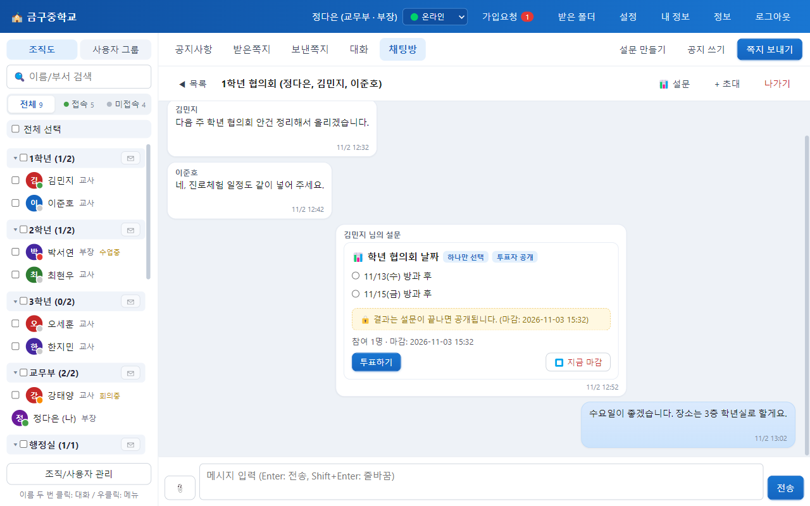

- **만들기**: 채팅방 탭의 **[+ 채팅방 만들기]** → 이름과 사람 고르기, 또는 사용자 그룹의 **[💬 채팅방]**
- 방 안에서 **[+ 초대]**로 사람 추가, **[나가기]**로 방에서 나가기
- 방 목록에 안 읽은 메시지 수가 표시됩니다.

### 9-3. 채팅방 설문 (그 방 사람들만 대상)

방 위쪽 **[📊 설문]** → 질문·항목(한 줄에 하나)·마감 시각을 정하고 **[설문 올리기]**.

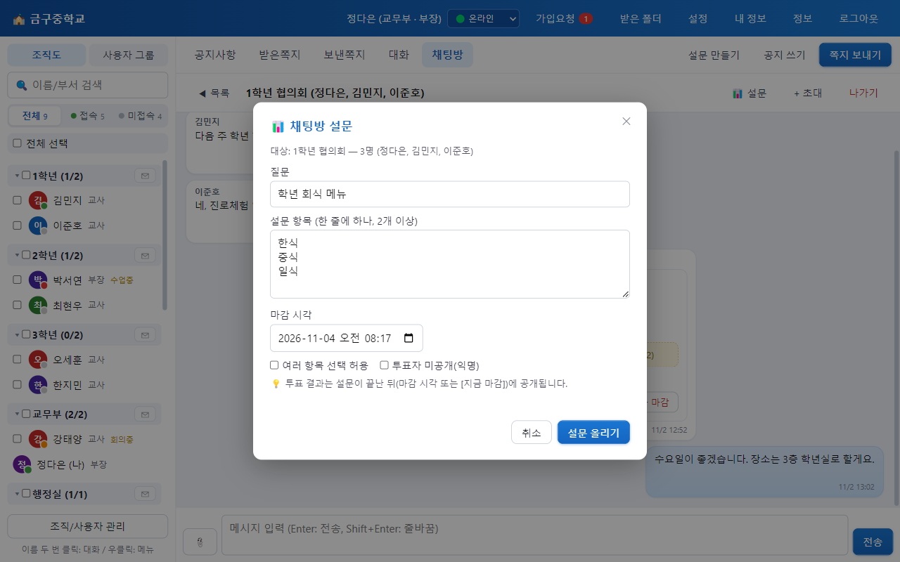

설문 선택 방식과 결과 공개 규칙은 공지 설문과 같습니다. → [10-3](#10-3-설문-결과-보기)

---

## 10. 공지사항과 설문조사

### 10-1. 공지 쓰기

1. 오른쪽 위 **[공지 쓰기]** → 제목·내용 입력
2. 필요하면 **📎 파일 첨부**, **⏰ 예약 공지**(정한 시각에 게시)
3. **[등록]** → 모든 교직원에게 알림이 갑니다.

- 공지는 작성자와 관리자가 공지 창의 **[✏ 수정] / [공지 삭제]**로 고칠 수 있습니다. (설문이 마감된 공지도 내용 수정 가능, 마감 상태는 그대로 유지)

### 10-2. 설문 만들기

**[설문 만들기]**(또는 공지 쓰기에서 ☑ 📊 설문조사 포함)

| 항목 | 설명 |
|---|---|
| 설문 항목 | 한 줄에 하나, 2개 이상 |
| 설문 마감 시각 | 이 시각이 되면 자동으로 마감되고 결과가 공개됩니다 |
| ☑ 여러 항목 선택 허용 | 끄면 **하나만 선택**, 켜면 **여러 개 선택** |
| ☑ 투표자 미공개(익명) | 켜면 누가 무엇을 골랐는지 아무도 볼 수 없습니다 |

### 10-3. 설문 결과 보기

**진행 중**에는 결과가 보이지 않고 **참여 인원과 내 선택**만 보입니다. 마감 전까지는 다시 골라 **[투표 변경]**할 수 있습니다.

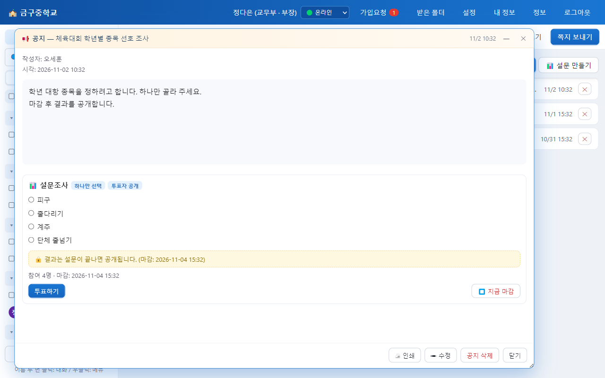

- 만든 사람·관리자는 **[⏹ 지금 마감]**으로 바로 끝내고 결과를 공개할 수 있습니다.

**마감 후**에는 항목별 표 수·비율이 공개되고, 공개 설문이면 항목마다 **투표한 사람 이름**이 표시됩니다.

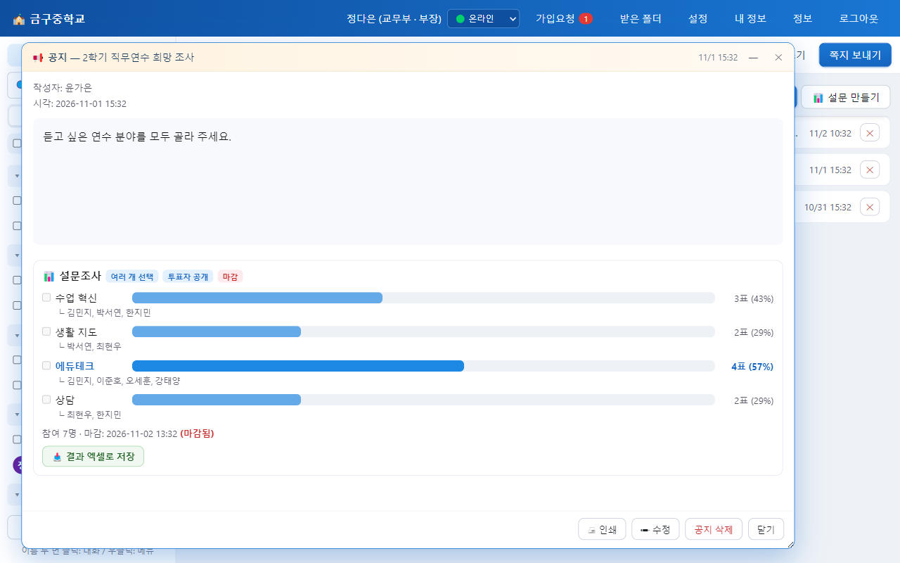

### 10-4. 결과를 엑셀로 저장

마감된 설문의 **[📥 결과 엑셀로 저장]** → 첨부파일 저장 폴더에 `설문결과_제목_날짜.xlsx`로 저장되고, 버튼이 **[📂 저장한 엑셀 열기]**로 바뀝니다.

| 시트 | 내용 |
|---|---|
| 결과 | 항목별 표 수·비율 |
| 응답자별 | 누가 무엇을 골랐는지 (공개 설문만) |
| 미참여 | 투표하지 않은 사람 명단 (공개 설문만) |

---

## 11. 조직도와 사용자 그룹

### 11-1. 조직도

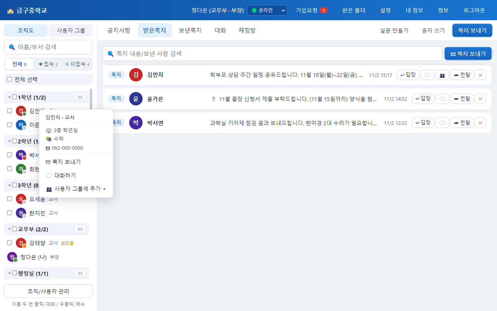

- 이름 옆 동그라미 색: 🟢 접속 · 🟡 자리비움 · 🔴 수업중 · 🟠 회의중 · ⚪ 미접속
- 위쪽 **[전체] [접속] [미접속]**으로 접속한 사람만 / 안 한 사람만 볼 수 있습니다. (괄호 = 인원 수)
- 이름 **우클릭**: 사무실·과목·전화번호 보기, ✉ 쪽지 보내기, 💬 대화하기, 👥 사용자 그룹에 추가

### 11-2. 사용자 그룹 (나만의 연락 그룹)

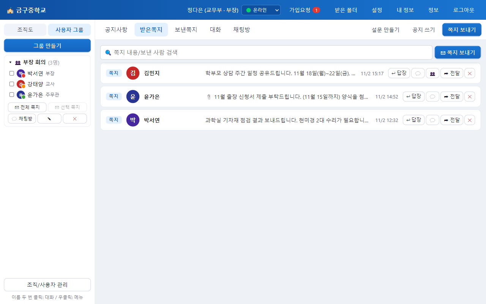

- 왼쪽 **[사용자 그룹]** 탭 → **[그룹 만들기]** → 이름과 사람 고르기
- 그룹 아래 버튼: **[✉ 전체 쪽지] [✉ 선택 쪽지] [💬 채팅방] [✎ 수정] [✕ 삭제]**
- **쪽지에서 바로 만들기**: 여러 명이 함께 받은 쪽지 창의 **[👥 N명으로 그룹 만들기]**(또는 목록의 👥) → 그 사람들과 그룹 이름이 미리 채워집니다.
- 사용자 그룹은 **나에게만** 보입니다. 다른 선생님에게는 보이지 않습니다.

---

## 12. 내 정보·설정

### 12-1. 내 정보

상단 **[내 정보]**: 부서·사무실 위치·담당 과목·전화·핸드폰·이메일 수정, **비밀번호 변경**(현재 비밀번호 + 새 비밀번호 2번).

### 12-2. 설정

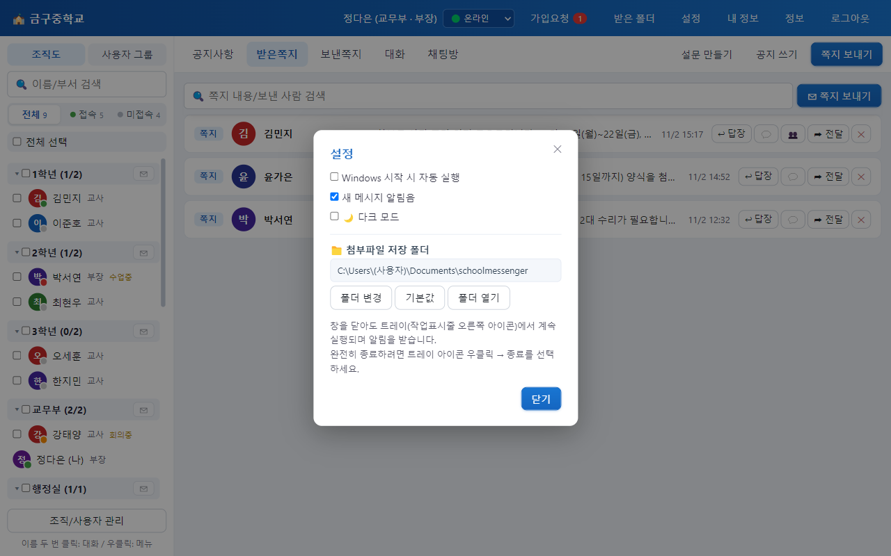

- **Windows 시작 시 자동 실행** · **새 메시지 알림음** · **🌙 다크 모드**
- **첨부파일 저장 폴더**: [폴더 변경] / [기본값] / [폴더 열기] (상단 [받은 폴더] 버튼으로도 열 수 있음)

---

## 13. 관리자 기능

관리자는 ① 서버 관리 화면, ② 관리자 권한이 있는 메신저 계정 두 곳에서 일할 수 있습니다.

### 13-1. 메신저에서 가입 승인

새 가입 요청이 오면 관리자 메신저에 알림이 뜹니다. 상단 **[가입요청]**(빨간 숫자 = 대기 건수) → **[✓ 승인] / [✕ 거절]**.

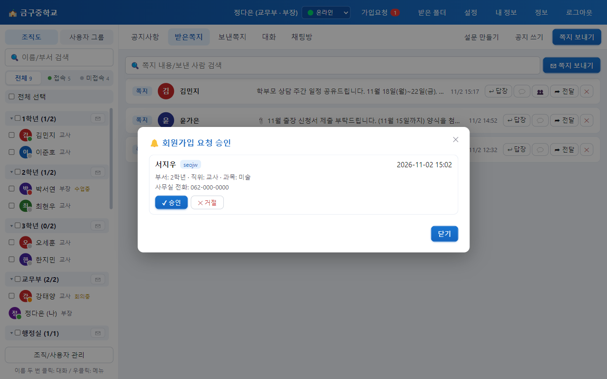

### 13-2. 메신저에서 계정 관리

왼쪽 아래 **[⚙ 조직/사용자 관리]**: 계정 추가·수정·삭제, 부서 이름 바꾸기(같은 이름으로 바꾸면 합쳐짐), 조직도 순서 끌어서 바꾸기.

### 13-3. 서버 관리 화면의 데이터 관리

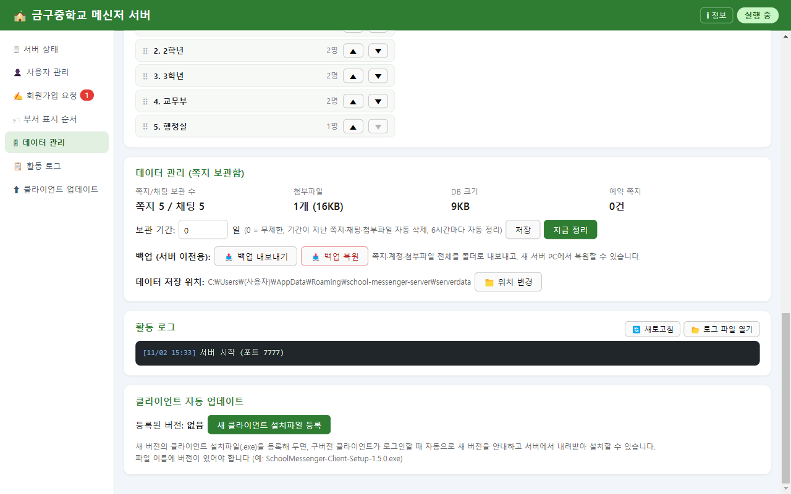

| 기능 | 설명 |
|---|---|
| 보관 기간 | 정한 일수가 지난 쪽지·채팅·첨부파일을 자동 삭제 (0 = 무제한, 6시간마다 정리). [지금 정리]로 바로 정리 |
| **백업 내보내기** | 계정·쪽지·첨부파일 전체를 폴더로 내보내기. **학기마다 한 번씩 해 두세요** |
| 백업 복원 | 내보낸 백업 폴더로 되돌리기 (새 서버 PC로 옮길 때도 사용) |
| 데이터 저장 위치 | 기본 `%APPDATA%\school-messenger-server\serverdata`, [위치 변경] 가능 |
| 활동 로그 | 로그인·발송·오류 기록 확인, [로그 파일 열기] |

### 13-4. 서버 PC를 바꿀 때

1. 기존 서버에서 **[백업 내보내기]**
2. 새 PC에 서버 설치 → **[백업 복원]**으로 그 폴더 선택
3. 새 PC의 접속 주소가 달라졌다면 교직원 메신저 로그인 화면의 서버 주소를 새 주소로 바꿉니다. (기존 주소와 새 주소를 쉼표로 함께 적어 두면 편합니다)

---

## 14. 업데이트 방법

### 14-1. 클라이언트 (교직원 PC) — 자동

1. 서버 관리 화면 맨 아래 **[클라이언트 자동 업데이트]** → **[새 클라이언트 설치파일 등록]** → 새 `SchoolMessenger-Client-Setup-x.x.x.exe` 선택
2. 교직원이 로그인하면 새 버전을 백그라운드로 내려받고, 상단에 **[지금 재시작하여 업데이트]** 배너가 뜹니다.
3. 버튼을 누르면 자동으로 설치하고 새 버전으로 다시 켜집니다. (배너를 닫고 그냥 메신저를 종료해도 종료할 때 자동 설치)

> 교직원 PC를 하나하나 돌아다닐 필요가 없습니다. 설치파일 등록은 **서버 PC에서 한 번**만 하면 됩니다.

### 14-2. 서버 — 직접 설치

1. 서버 PC에서 새 `SchoolMessenger-Server-Setup-x.x.x.exe`를 실행해 같은 폴더에 덮어 설치합니다. (서버가 실행 중이라는 안내가 나오면 [확인] → 자동으로 닫힙니다)
2. **계정·쪽지·첨부파일은 그대로 유지**됩니다. (데이터는 설치 폴더가 아니라 데이터 저장 위치에 있음)
3. [마침]을 누르면 서버가 다시 켜지고, 교직원 메신저는 잠시 "연결 끊김"이 됐다가 **자동으로 다시 연결**됩니다.

> 💡 업데이트 전에 [백업 내보내기]를 한 번 해 두면 더 안전합니다. 쉬는 시간이나 방과 후에 하는 것을 권장합니다.

---

## 15. 자주 묻는 질문 / 문제 해결

**Q. 로그인할 때 "서버에 연결할 수 없습니다"가 떠요.**
1. 서버 PC가 켜져 있고 트레이에 서버 아이콘이 있는지 확인
2. 서버 주소를 서버 관리 화면의 **접속 주소**와 똑같이 입력했는지 확인 (`:7777` 포트 포함)
3. 서버 PC의 방화벽에서 학교메신저 서버가 허용되어 있는지 확인
   → 제어판 › Windows Defender 방화벽 › **앱이 방화벽을 통과하도록 허용** › [설정 변경] › "SchoolMessengerServer"의 **개인/공용** 체크 (목록에 없으면 [다른 앱 허용]으로 설치 폴더의 `SchoolMessengerServer.exe` 추가)
4. 서버 PC의 주소가 바뀌었을 수 있습니다 (DHCP). 서버 관리 화면에서 현재 주소를 다시 확인하고, 가능하면 전산 담당자에게 **고정 IP**를 요청하세요.

**Q. 비밀번호를 잊어버렸어요.**
관리자에게 요청하세요. 관리자는 서버 관리 화면 [사용자 관리] 또는 메신저 [조직/사용자 관리]에서 **[수정·비밀번호]**로 새 비밀번호를 정해 줄 수 있습니다.

**Q. 가입 요청을 보냈는데 로그인이 안 돼요.**
관리자가 아직 승인하지 않은 상태입니다. 승인되면 바로 로그인할 수 있습니다.

**Q. 알림이 안 와요.**
- 메신저 창을 ✕로 닫아도 트레이에서 알림을 받습니다. 트레이에서 **종료**하면 알림이 오지 않습니다.
- Windows 설정 › 시스템 › 알림에서 "학교메신저" 알림이 켜져 있는지, **방해 금지 모드**가 꺼져 있는지 확인하세요.
- 소리는 메신저 [설정]의 **새 메시지 알림음**으로 켜고 끕니다.

**Q. 받은 첨부파일은 어디에 있나요?**
상단 **[받은 폴더]** 버튼을 누르면 열립니다. (기본 `문서\schoolmessenger`)

**Q. 쪽지를 잘못 보냈어요.**
보낸쪽지함에서 그 쪽지를 열고 **[회수]**를 누르면 상대가 읽었더라도 상대 쪽지함에서 사라집니다.

**Q. 설문 결과가 안 보여요.**
결과는 **마감 후에만** 공개됩니다. 만든 사람이나 관리자가 [⏹ 지금 마감]을 누르면 바로 공개됩니다.

**Q. 서버 PC를 꺼도 되나요?**
서버가 꺼져 있는 동안에는 아무도 메신저를 쓸 수 없습니다. 서버 PC는 업무 시간 동안 켜 두고, 절전 모드로 들어가지 않게 설정하세요. 다시 켜면 교직원 메신저는 자동으로 다시 연결됩니다.

---
ⓒ jiseok
